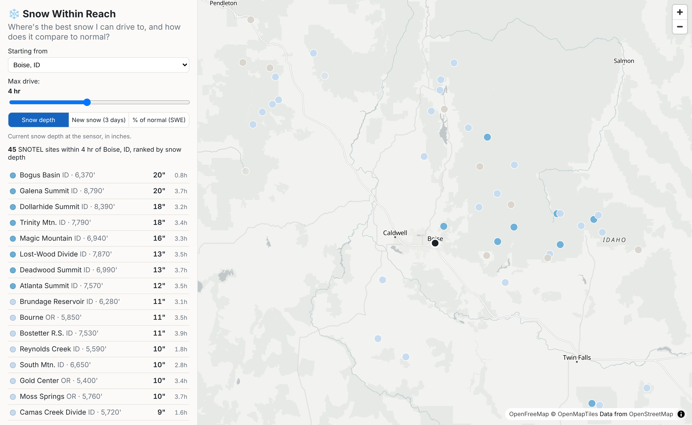
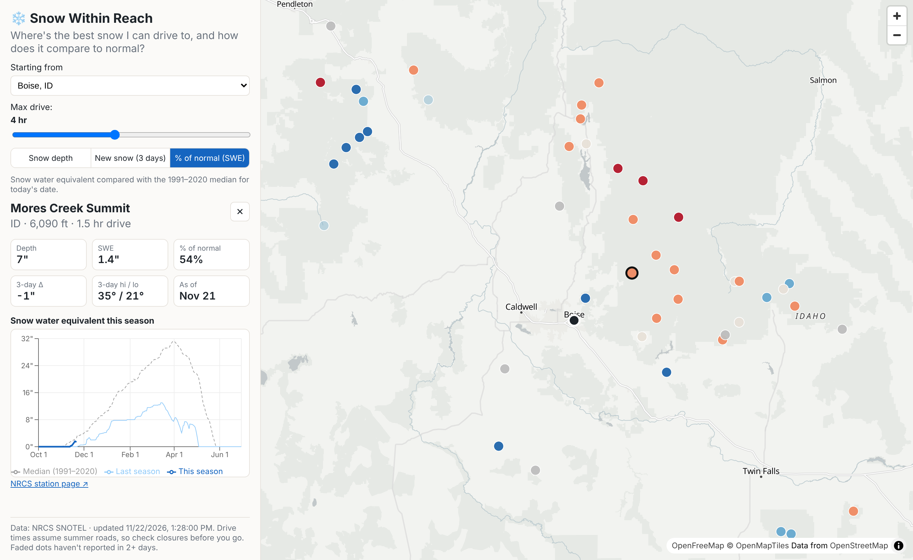
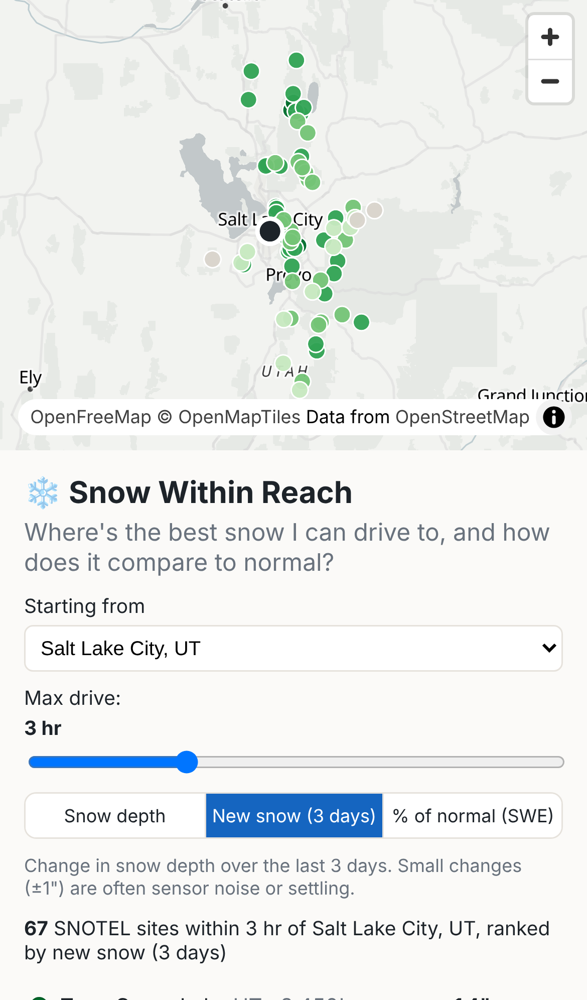

# ❄️ Snow Within Reach

**Where's the best snow I can drive to, and how does it compare to normal?**

A map of every SNOTEL snow station in the western US, filtered by how far you're willing to drive and
ranked by snow depth, new snow, or percent of normal. Data refreshes every 3 hours from the NRCS.

**Live site:** https://benhcalvert.github.io/snow/ · **Example:** [4 hours from Boise, ranked by % of normal](https://benhcalvert.github.io/snow/?from=boise&hours=4&metric=pctMed)



<p align="center">
  
  
</p>

## Why I built this

I ski in the backcountry around Boise. Every Thursday I'd open the NRCS map, click through station pages, check Google
Maps for drive times, and try to remember whether 20 inches is good for November. The data is all public, but it's built
for hydrologists, not for someone deciding where to drive on Saturday.

This project is a case study in going from a personal pain point to a scoped, shipped product:

| | |
|---|---|
| 📄 [Product brief](docs/PRODUCT.md) | Problem, personas, jobs to be done, V1 scope and cuts, success metrics, roadmap |
| 🧭 [Decision log](docs/DECISIONS.md) | Each key trade-off: what I chose, what I gave up, when to revisit |
| 🎙️ [User research plan](docs/USER_RESEARCH.md) | Assumptions to test and the interview guide |

## How it works

```
NRCS AWDB API ──(every 3 h, GitHub Actions)──▶ pipeline/build_data.py ──▶ static JSON ──▶ React + MapLibre site (GitHub Pages)
OSRM router ──(one-time)──▶ pipeline/build_drive_times.py ──▶ drive times from 15 hub cities (committed)
```

- **No backend, $0 to run.** A scheduled GitHub Action fetches data for ~840 stations, writes JSON, and deploys.
- **Drive times are precomputed** from 15 mountain-west cities, so the live site never depends on a routing service.
- **Data quality is handled explicitly:** stale stations fade out, sensor noise is explained in the UI, and the metric
  logic is unit-tested (`pipeline/tests`).

## Run it locally

```bash
python3 pipeline/build_data.py                 # ~5 min; writes web/public/data/
# (optional, slow) python3 pipeline/build_drive_times.py   # rebuild drive times
cd web && npm install && npm run dev           # http://localhost:5173
python3 -m unittest discover -s pipeline/tests # tests
```

Tip: `python3 pipeline/build_data.py --states ID,OR` builds a smaller dataset in under a minute.

## Repo layout

| Path | What |
|---|---|
| `web/` | React + TypeScript + MapLibre GL + Recharts front end (Vite) |
| `pipeline/` | Python (standard library only) data pipeline and tests |
| `.github/workflows/deploy.yml` | Scheduled refresh + GitHub Pages deploy |
| `docs/` | Product brief, decision log, research plan, screenshots |
| `.claude/skills/snotel-data/` | A Claude skill + CLI (`snotel.py`) for ad-hoc SNOTEL queries (see below) |

## Data sources and credits

- Snow data: [USDA NRCS SNOTEL](https://www.nrcs.usda.gov/wps/portal/wcc/home/) via the AWDB REST API (public domain)
- Drive times: [OSRM](https://project-osrm.org/) on OpenStreetMap data, summer road network (check winter closures!)
- Basemap: [OpenFreeMap](https://openfreemap.org/) / [OpenMapTiles](https://openmaptiles.org/) © OpenStreetMap contributors

*SNOTEL stations measure snow at a single point, usually a sheltered clearing. Use this to decide where to look,
not as a statement about avalanche or slope conditions. Always check your local avalanche center.*

---

## Bonus: SNOTEL command-line tool

`.claude/skills/snotel-data/scripts/snotel.py` is a standalone, standard-library tool for ad-hoc queries.
It's also packaged as a Claude skill (`dist/snotel-data.skill`).

```bash
S=.claude/skills/snotel-data/scripts/snotel.py
python3 $S find "mores"                                                  # station ID lookup
python3 $S data 637:ID:SNTL --start 2020-11-25 --end 2020-11-29 --median # history vs. median
python3 $S near --lat 43.615 --lon -116.202 --hours 4 --conditions      # sites within a drive
```

API notes, element codes, and gotchas: [`references/api.md`](.claude/skills/snotel-data/references/api.md).
